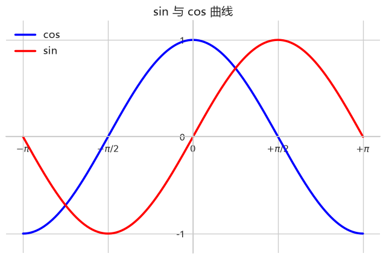
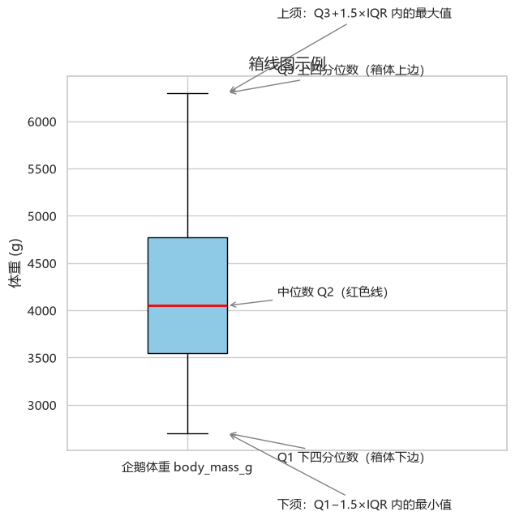
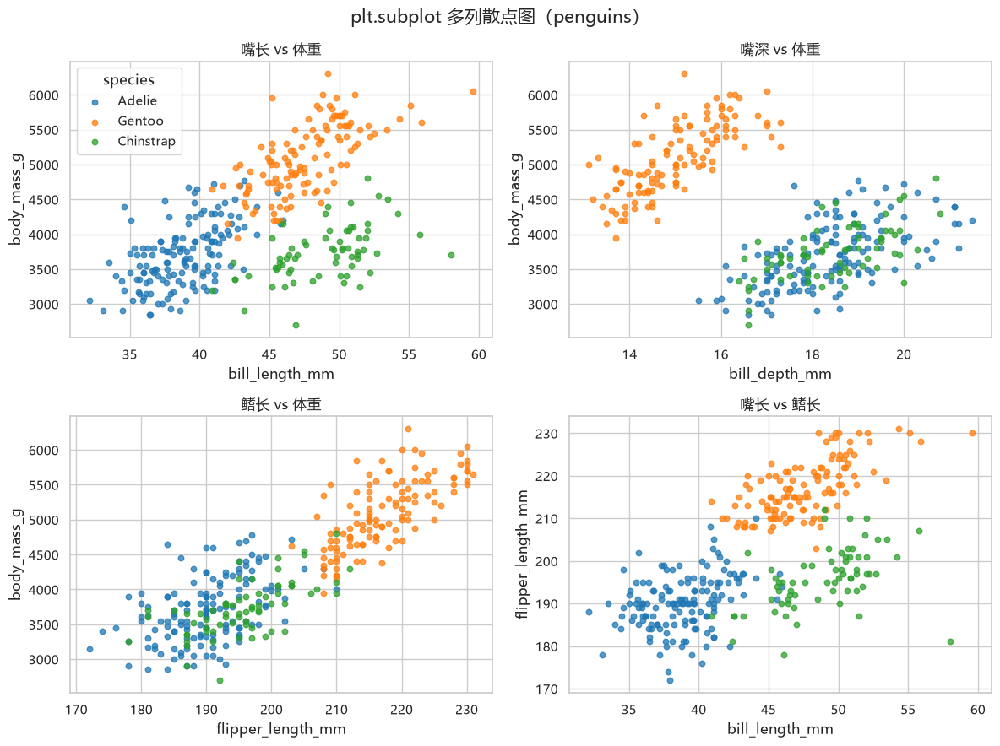
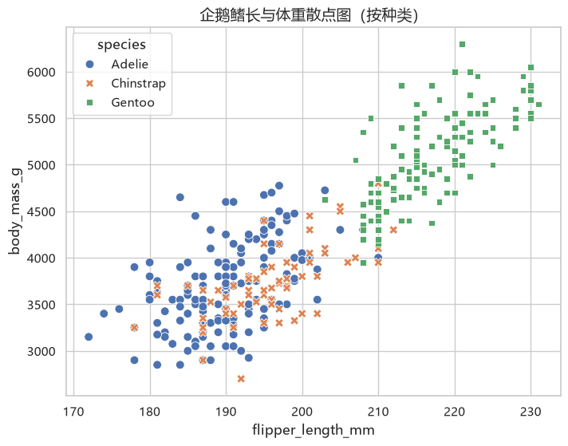
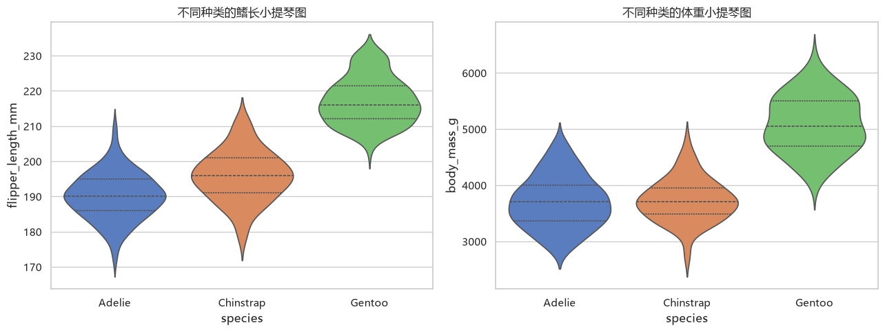
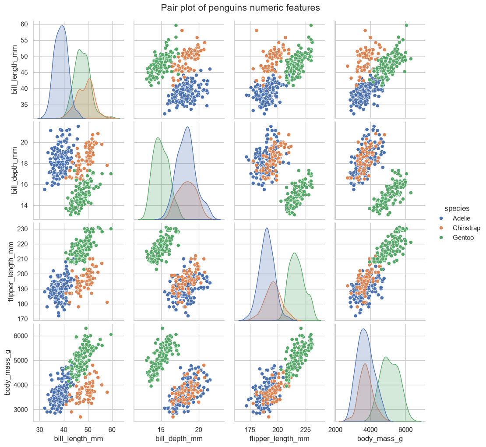
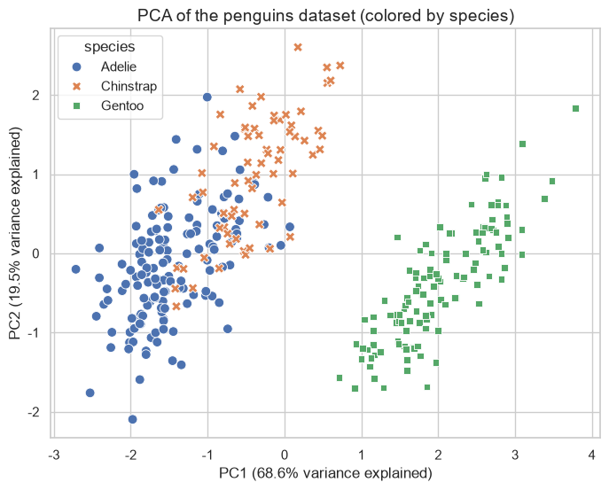

# Data Analysis Assignment

> A data analysis course assignment completed in Python: from data-preprocessing fundamentals and visualization to exploratory analysis and PCA on the seaborn `penguins` dataset — all packaged as a runnable Jupyter notebook.


**Author:** Hejuntian Huang | **Student ID:** 22301170100

---

##  Assignment Requirements

The assignment consists of 6 questions. Each question has its own section in the notebook (theory questions are answered in Markdown, hands-on questions include runnable code with saved outputs).

| # | Question 
|---|---
| 1 | What steps are involved in data preprocessing?
| 2 | What is an outlier?
| 3 | Reproduce an elegant sin and cos plot
| 4 | Draw a grid of scatter plots with `plt.subplot` 
| 5 | Draw a boxplot and explain each part of the box 
| 6* | Use the penguins dataset: explore its features, draw a scatter plot, boxplot, violin plot and pair plot, and perform PCA 
> Question 6 (marked with \*) is the bonus question and the main body of this assignment.

---

##  Repository Structure

```
.
├── Data_Analysis_Assignment.ipynb   # The assignment notebook (executed, outputs saved)
├── images/                          # Preview figures extracted from the notebook
│   ├── 01_sin_cos.png
│   ├── 02_subplot_scatter.png
│   ├── 03_boxplot.png
│   ├── 04_scatter.png
│   ├── 05_violin.png
│   ├── 06_pairplot.png
│   └── 07_pca.png
├── requirements.txt                 # Dependencies
└── README.md
```

All cell outputs (figures and statistics) have been executed and saved inside the notebook — **you can view the full results right after cloning, without running anything**.

---

##  Quick Start

```bash
git clone https://github.com/hhjacky625/Python_Data-analysis-assignment.git
cd Python_Data-analysis-assignment

# a virtual environment is recommended
pip install -r requirements.txt

jupyter notebook
```

Open `Data_Analysis_Assignment.ipynb` and click **Run All** to reproduce every result.

> The first run of `sns.load_dataset("penguins")` requires an internet connection to download the dataset; seaborn caches it afterwards.

---

##  What's Inside

**Q1–Q2**: Concept overview of data preprocessing and outliers, with comparison tables of the steps / detection methods and when to use them.

**Q3**: A sin / cos plot with Matplotlib — smooth curves via `np.linspace`, ticks in multiples of π, top/right spines hidden, left/bottom spines moved to the origin.

**Q4**: `plt.subplot(2, 2, i)` lays out 4 subplots showing pairwise scatter relationships among bill length, bill depth, flipper length and body mass, colored by penguin species.

**Q5**: A boxplot of penguin body mass with arrow annotations for Q1, Q3, the median, the whiskers and outliers, plus a written explanation of each part.

**Q6** (core):
- **Data exploration**: 344 rows × 7 columns, 3 species (Adelie 152 / Gentoo 124 / Chinstrap 68), per-column missing values, 333 rows after cleaning;
- **Visualization**: scatter plot, grouped boxplots, violin plots (with embedded quartiles), pair plot (KDE on the diagonal);
- **PCA**: the 4 numeric features are standardized and reduced to 2 dimensions — **PC1 explains 68.6%, PC2 explains 19.4%, 88.1% cumulatively** — with the loadings matrix and a 2-D scatter plot; Gentoo is clearly separated in the PC plane.

---

##  Result Previews

| sin & cos curves | Boxplot annotations |
|---|---|
|  |  |

| Scatter grid with `plt.subplot` |
|---|
|  |

| Penguins scatter plot | Grouped violin plots |
|---|---|
|  |  |

| Pair plot | PCA result |
|---|---|
|  |  |

---

##  Environment

- Python 3.13
- pandas · numpy · matplotlib · seaborn · scikit-learn · jupyter

See [requirements.txt](requirements.txt) for version details.

---

## 📄 License

This repository is archived coursework for learning purposes. Please credit the source if you reuse the code or figures.
